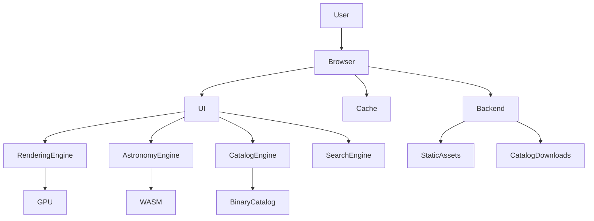
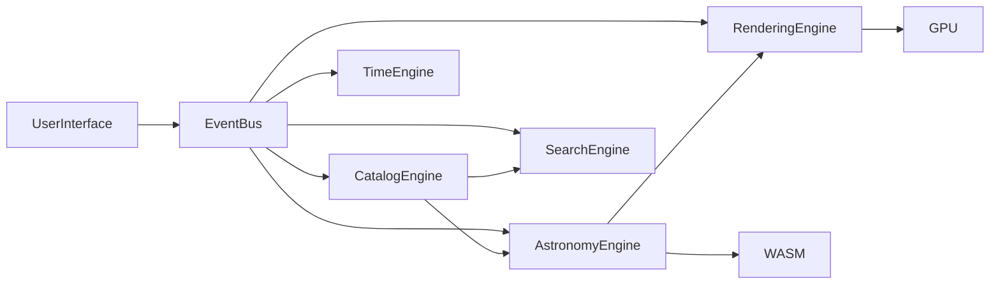
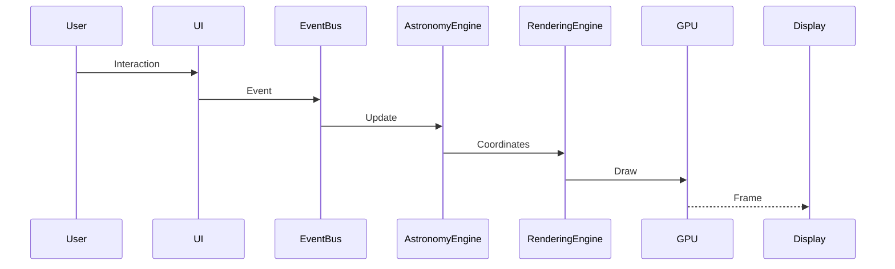

# Software Requirements Specification (SRS)

# StarTracker

## A High-Performance Browser-Based Astronomical Visualization Engine

**Document Version:** 1.0

**Status:** Draft

---

# Part 1A — Introduction and Project Goals

---

# 1. Document Purpose

## 1.1 Purpose

This Software Requirements Specification (SRS) defines the functional requirements, non-functional requirements, architectural principles, design philosophy, and engineering constraints for the **StarTracker** project.

StarTracker is designed as a high-performance, browser-based astronomical visualization engine that enables users to observe the night sky from any location on Earth in real time. Unlike traditional star chart applications, StarTracker is intended to function as a scientific visualization platform capable of displaying accurate stellar positions while maintaining interactive frame rates on modern consumer hardware.

This document serves as the primary technical reference throughout the software development lifecycle. It establishes a common understanding of system behavior, interfaces, performance targets, and implementation goals for developers, researchers, contributors, and future maintainers.

The SRS intentionally focuses on long-term maintainability and extensibility. Architectural decisions documented here prioritize scientific accuracy, computational efficiency, and modular software design over rapid feature implementation.

---

## 1.2 Objectives of this Document

This document aims to:

- Define the scope of the project.
- Describe the intended functionality of the system.
- Specify performance and accuracy requirements.
- Establish the overall software architecture.
- Document design constraints and assumptions.
- Provide a foundation for future development phases.
- Serve as a reference for testing and verification.

---

## 1.3 Document Conventions

The following conventions are used throughout this document.

### Requirement Statements

Mandatory requirements use the keyword:

**SHALL**

Example:

> The system SHALL calculate apparent stellar positions using the selected observation time.

Recommendations use:

**SHOULD**

Optional functionality uses:

**MAY**

---

## 1.4 Intended Audience

This document is intended for:

- Software engineers
- Scientific software developers
- Astronomers
- Physics students
- Contributors
- Researchers
- Test engineers
- Future maintainers

Readers are expected to possess basic familiarity with software development concepts. Knowledge of astronomy or celestial mechanics is beneficial but not required.

---

# 2. Project Scope

## 2.1 Overview

StarTracker is a web-based astronomical visualization platform that computes and displays the positions of stars as viewed from any observer location on Earth.

The application combines accurate astronomical algorithms with high-performance rendering techniques to produce an interactive sky simulation capable of operating entirely inside a web browser.

The application supports:

- Real-time sky visualization
- Interactive star selection
- Coordinate transformations
- Rise, transit, and set time calculations
- Star catalog exploration
- Scientific measurements
- Educational use

The software is intended to bridge the gap between lightweight educational star maps and professional astronomical software by providing scientific accuracy without sacrificing responsiveness.

---

## 2.2 In Scope

The first release SHALL include:

- Real-time star rendering
- Interactive sky map
- Observer location selection
- Automatic time synchronization
- Star catalog browsing
- Search functionality
- Multiple celestial coordinate systems
- Rise and set calculations
- Local sidereal time
- Atmospheric refraction
- Proper motion corrections
- High-performance rendering
- Offline functionality
- Responsive user interface

---

## 2.3 Out of Scope

The initial version SHALL NOT include:

- Telescope control
- Astrophotography tools
- Image processing
- Planetarium dome projection
- Observatory automation
- Real-time weather forecasting
- Professional astrometry
- Radio astronomy visualization

These capabilities are considered future extensions.

---

# 3. Project Vision

## 3.1 Vision Statement

The long-term vision of StarTracker is to become a modern, browser-native astronomical visualization engine that combines the computational performance of desktop applications with the accessibility of the web.

Rather than functioning as a conventional website, StarTracker will operate as a scientific graphics engine capable of rendering and analyzing astronomical datasets interactively while maintaining real-time performance.

The project seeks to demonstrate that advances in WebAssembly, GPU acceleration, and modern browser technologies enable sophisticated scientific software to execute efficiently without requiring native installation.

---

## 3.2 Guiding Principles

The project is guided by the following principles.

### Scientific Accuracy

Astronomical calculations shall follow internationally accepted standards whenever practical.

Examples include:

- IAU precession models
- IAU nutation models
- J2000 reference frame
- Standard sidereal time algorithms

---

### Performance First

Performance is considered a primary feature rather than a secondary optimization.

Every subsystem shall be designed with computational efficiency as a core requirement.

Whenever possible:

- expensive calculations shall be cached,
- repeated trigonometric operations shall be minimized,
- memory allocations shall be reduced,
- vectorized computations shall be preferred.

---

### Client-Side Computation

The browser shall perform nearly all astronomical calculations locally.

The server should function primarily as a content delivery service rather than a computational backend.

This design minimizes latency while enabling offline operation.

---

### Modularity

Every subsystem shall be independently replaceable.

Examples include:

- rendering engine
- astronomy engine
- catalog engine
- search engine
- user interface

Loose coupling reduces long-term maintenance costs.

---

### Extensibility

Future features shall integrate without requiring architectural redesign.

Examples include:

- planets
- satellites
- Gaia catalogs
- telescope control
- WebGPU renderer
- virtual reality

---

# 4. Definitions and Terminology

| Term | Definition |
|-------|------------|
| RA | Right Ascension |
| Dec | Declination |
| Alt | Altitude |
| Az | Azimuth |
| LST | Local Sidereal Time |
| WASM | WebAssembly |
| SIMD | Single Instruction Multiple Data |
| GPU | Graphics Processing Unit |
| SoA | Structure of Arrays |
| AoS | Array of Structures |
| KD Tree | Spatial indexing structure |
| Apparent Coordinates | Coordinates corrected for observational effects |
| ICRS | International Celestial Reference System |
| UTC | Coordinated Universal Time |
| JD | Julian Date |

---

# 5. Overall Objectives

The primary objectives of StarTracker are summarized below.

## OBJ-001

The system SHALL accurately display stellar positions for any observer on Earth.

---

## OBJ-002

The system SHALL maintain smooth interactive rendering at a target refresh rate of 60 frames per second on modern consumer hardware.

---

## OBJ-003

The system SHALL support multiple astronomical coordinate systems without requiring page reloads.

---

## OBJ-004

The system SHALL calculate rise, transit, and set times for observable stars.

---

## OBJ-005

The system SHALL allow users to inspect detailed information for individual stars.

---

## OBJ-006

The system SHALL execute the majority of scientific calculations within the browser.

---

## OBJ-007

The application SHALL remain responsive while rendering tens of thousands of stars simultaneously.

---

## OBJ-008

The software SHALL be modular enough to support future astronomical datasets.

---

# 6. Design Philosophy

StarTracker is designed as an **astronomical engine** rather than a conventional web application.

Most web applications follow a request-response architecture where computation occurs on a server.

StarTracker adopts the opposite approach.

The browser becomes the computational platform.

The server becomes a lightweight content distribution service.

Scientific calculations execute locally through a WebAssembly module compiled from Rust.

Rendering is performed directly on the GPU through WebGL2.

This architecture minimizes latency, improves scalability, reduces server costs, and enables offline execution.

Every major subsystem is isolated behind well-defined interfaces to simplify future enhancements and independent optimization.

---

# 7. Primary Features

The initial release includes the following core capabilities.

## Sky Visualization

- Real-time stellar positions
- Continuous celestial motion
- Interactive panning
- Zooming
- Rotation
- Horizon visualization
- Cardinal directions
- Coordinate grids

---

## Star Catalog

- Bright Star Catalog
- Hipparcos Catalog
- Binary storage
- Instant search
- Filtering
- Sorting

---

## Scientific Calculations

- Sidereal time
- Coordinate conversion
- Atmospheric refraction
- Rise and set calculations
- Proper motion
- Apparent coordinates

---

## User Interaction

- Clickable stars
- Search
- Star information panel
- Time controls
- Observer controls

---

## Offline Capability

- Progressive Web App
- Local catalog cache
- Offline rendering
- Offline calculations

---

# 8. Non-Goals

The following objectives are intentionally excluded from the initial release.

- Professional observatory automation
- Telescope mount control
- CCD camera control
- Image stacking
- Astrometric reduction
- Spectroscopic analysis
- Cosmological simulations
- N-body simulations

These capabilities may be considered for future releases but shall not influence the architecture of the first production version.

---

# 9. Assumptions

The following assumptions apply throughout the project.

- Users possess a modern standards-compliant web browser.
- JavaScript is enabled.
- WebAssembly is supported.
- WebGL2 is available.
- The user's system clock is reasonably accurate.
- Internet connectivity is available during the initial application download.
- Browser local storage is available for caching.

---

# 10. Constraints

The system shall operate within the following constraints.

- Browser sandbox restrictions.
- Limited GPU memory.
- Cross-platform compatibility.
- Variable network bandwidth.
- Mobile device resource limitations.
- Browser security policies.

These constraints influence numerous architectural decisions throughout the project.

---

# 11. Quality Attributes

The architecture is designed around the following quality attributes, listed in descending order of priority.

1. Performance
2. Scientific Accuracy
3. Reliability
4. Maintainability
5. Scalability
6. Extensibility
7. Usability
8. Accessibility
9. Portability
10. Security

Every design decision should be evaluated against these attributes.

---

# 12. Success Criteria

The initial release shall be considered successful if it satisfies the following measurable goals.

| ID | Requirement |
|----|-------------|
| SC-001 | Render the visible sky at 60 FPS under normal operating conditions. |
| SC-002 | Display accurate stellar positions with an error below one arcminute for supported catalogs. |
| SC-003 | Compute rise and set times within ±10 seconds of accepted astronomical references. |
| SC-004 | Support interactive searching across the complete star catalog with sub-50 ms response time. |
| SC-005 | Operate entirely offline after the initial installation and catalog download. |
| SC-006 | Scale to future catalogs containing at least one million stars without requiring architectural redesign. |
| SC-007 | Maintain a modular architecture where rendering, astronomy, catalog management, and user interface components can evolve independently. |

---

**End of Part 1A**

# Part 1B-I — High-Level Architecture

---

# 13. Architectural Overview

## 13.1 Introduction

StarTracker is designed as a **high-performance astronomical visualization engine** rather than a traditional web application. Although users interact with it through a web browser, the software internally behaves much like a scientific simulation engine or lightweight game engine.

The system combines:

- A real-time rendering engine
- An astronomy computation engine
- A catalog management engine
- A user interface layer
- A lightweight backend for static asset delivery

The architecture emphasizes:

- Low latency
- Scientific accuracy
- Modular subsystem design
- Efficient memory usage
- Hardware acceleration
- Offline functionality
- Long-term extensibility

Unlike conventional websites where computation occurs primarily on the server, StarTracker performs nearly all astronomical calculations locally within the browser. This minimizes latency, reduces server costs, improves responsiveness, and allows the application to operate without a continuous network connection.

---

## 13.2 Architectural Philosophy

The architecture follows six guiding principles.

### AP-001 — Computation Near the User

Astronomical calculations SHALL execute on the client whenever practical.

This reduces network latency and enables real-time interaction.

Examples include:

- Coordinate transformations
- Sidereal time computation
- Rise and set calculations
- Proper motion propagation
- Apparent coordinate correction
- Atmospheric refraction

---

### AP-002 — GPU-Centric Rendering

The Graphics Processing Unit (GPU) SHALL perform all rendering-intensive operations.

The CPU is reserved for:

- Astronomy
- Scheduling
- User interaction
- Catalog management

Rendering SHALL minimize CPU-GPU synchronization to maintain high frame rates.

---

### AP-003 — Modular Engine Design

The application SHALL consist of independent engines communicating through well-defined interfaces.

Subsystems SHALL NOT depend directly upon one another unless explicitly documented.

Loose coupling improves maintainability and enables future replacement or optimization of individual engines.

---

### AP-004 — Data-Oriented Design

Internal data structures SHALL prioritize memory locality and cache efficiency over object-oriented organization.

Whenever feasible, the software SHALL use:

- Structure of Arrays (SoA)
- Typed Arrays
- Sequential memory layouts
- Immutable catalog data

This approach improves CPU cache utilization and enables SIMD optimization.

---

### AP-005 — Progressive Loading

The application SHALL become interactive before all assets have been downloaded.

Initial startup SHALL prioritize:

1. User interface
2. Rendering engine
3. Core star catalog
4. Optional datasets

Additional resources SHALL load asynchronously.

---

### AP-006 — Scalability by Design

The architecture SHALL support significantly larger catalogs than those included in the initial release.

Future datasets should integrate without requiring architectural redesign.

Examples include:

- Gaia DR3
- Deep Sky Objects
- Satellites
- Asteroids
- Comets
- Planetary ephemerides

---

# 14. System Context

The following diagram illustrates the highest-level system architecture.



The backend functions primarily as a content distribution service.

No continuous server-side computation is required during normal operation.

---

# 15. Core Subsystems

The software is organized into several independent subsystems.

---

## 15.1 User Interface Layer

Responsibilities:

- Window layout
- User interaction
- Settings
- Search interface
- Tables
- Dialogs
- Time controls
- Location controls

The UI SHALL remain independent of rendering and scientific computation.

Its primary responsibility is presenting information and forwarding user actions to the appropriate subsystem.

---

## 15.2 Rendering Engine

Responsibilities:

- Sky rendering
- Label rendering
- Horizon rendering
- Coordinate grids
- Camera
- Zoom
- Projection
- Selection highlighting

The Rendering Engine SHALL receive already-computed astronomical coordinates.

It SHALL NOT perform astronomical calculations internally.

---

## 15.3 Astronomy Engine

Responsibilities:

- Coordinate transformations
- Sidereal time
- Rise/set calculations
- Atmospheric refraction
- Proper motion
- Precession
- Nutation
- Time systems

The Astronomy Engine SHALL be implemented in Rust and compiled to WebAssembly.

---

## 15.4 Catalog Engine

Responsibilities:

- Binary catalog loading
- Catalog indexing
- Memory management
- Spatial indexing
- Metadata lookup

Catalog data SHALL remain immutable after loading.

---

## 15.5 Search Engine

Responsibilities:

- Prefix search
- Full text search
- Identifier lookup
- Spatial search

Search operations SHALL execute independently of rendering.

---

## 15.6 Time Engine

Responsibilities:

- UTC
- Local time
- Julian Date
- Sidereal Time
- Simulation speed
- Time controls

The Time Engine SHALL provide a consistent temporal reference for all subsystems.

---

## 15.7 Asset Manager

Responsibilities:

- Fonts
- Icons
- Catalog downloads
- Shader loading
- Texture loading

Assets SHALL load asynchronously.

---

# 16. Client–Server Responsibilities

Unlike conventional web applications, StarTracker intentionally minimizes server responsibilities.

---

## 16.1 Client Responsibilities

The browser SHALL perform:

- Astronomy calculations
- Rendering
- Search
- Catalog filtering
- Coordinate transformations
- Visibility calculations
- Rise/set computations
- Simulation

This architecture significantly reduces server load.

---

## 16.2 Server Responsibilities

The backend SHALL provide only:

- Static HTML
- JavaScript bundles
- WebAssembly binaries
- Binary star catalogs
- Optional update metadata

The backend SHALL NOT perform astronomical calculations.

This design permits deployment through static hosting services.

---

# 17. High-Level Engine Architecture

The following diagram illustrates subsystem relationships.



The Event Bus coordinates communication while preventing unnecessary coupling between engines.

---

# 18. Primary Data Flow

The following sequence occurs during a normal frame.



Only the minimum required information is exchanged between subsystems.

Large datasets remain inside the Catalog Engine.

---

# 19. Architectural Decision Records (ADRs)

This project adopts several key architectural decisions.

---

## ADR-001 — Browser-First Architecture

Decision:

Execute nearly all scientific computation inside the browser.

Reasoning:

- Eliminates network latency.
- Supports offline operation.
- Reduces infrastructure costs.
- Improves scalability.

Consequences:

- Increased browser memory usage.
- Greater reliance on WebAssembly.
- Improved responsiveness.

---

## ADR-002 — Rust for Scientific Computation

Decision:

Implement computationally intensive algorithms in Rust.

Reasoning:

- Native performance.
- Strong memory safety.
- SIMD support.
- Excellent WebAssembly integration.

Consequences:

- Slightly more complex build pipeline.
- Significantly improved computational efficiency.

---

## ADR-003 — WebGL2 Rendering

Decision:

Use WebGL2 as the primary rendering backend.

Reasoning:

- Hardware acceleration.
- Wide browser support.
- Instanced rendering.
- Mature tooling.

Future versions MAY introduce WebGPU while maintaining compatibility with WebGL2.

---

## ADR-004 — Binary Catalog Storage

Decision:

Store astronomical catalogs in binary format rather than JSON or CSV.

Reasoning:

- Reduced download size.
- Faster loading.
- No parsing overhead.
- Improved memory locality.

---

## ADR-005 — Structure of Arrays (SoA)

Decision:

Organize catalog data using Structure of Arrays.

Reasoning:

- Improved CPU cache utilization.
- SIMD compatibility.
- Efficient bulk processing.
- Better memory bandwidth utilization.

---

# 20. Quality Goals

The architecture is designed to satisfy the following measurable goals.

| Goal | Target |
|-------|--------|
| Startup Time | < 2 seconds |
| Initial Sky Display | < 1 second |
| Frame Rate | 60 FPS |
| Coordinate Update | < 5 ms |
| Search Latency | < 25 ms |
| Catalog Loading | Progressive |
| Offline Capability | Fully Supported |
| Future Catalog Size | ≥ 100 million stars (streamed and tiled) |

These targets guide architectural decisions throughout the remainder of the project.

---

**End of Part 1B-I**

# Part 1B-IIA — Core Engine Architecture

---

# 21. Core Engine Architecture

## 21.1 Purpose

The Core Engine is the foundation upon which every other subsystem is built.

Unlike traditional web applications where individual components communicate directly with one another, StarTracker adopts a layered engine architecture. Every subsystem interacts through standardized interfaces coordinated by the Core Engine.

The Core Engine SHALL be responsible for:

- Application lifecycle management
- Scheduling subsystem execution
- Resource management
- Event distribution
- Configuration management
- Plugin management
- Global state synchronization

The Core Engine SHALL NOT perform astronomical calculations or rendering directly. Instead, it orchestrates specialized engines responsible for those tasks.

---

## 21.2 Design Objectives

The Core Engine is designed to satisfy the following objectives:

| Objective | Description |
|------------|-------------|
| Modularity | Engines operate independently. |
| Low Coupling | Minimize dependencies between subsystems. |
| High Cohesion | Each engine performs one primary responsibility. |
| Scalability | Support future engines without architectural redesign. |
| Performance | Minimize synchronization overhead. |
| Extensibility | New features integrate through plugins or engine registration. |

---

# 22. Engine Hierarchy

The internal architecture follows a layered design.

```text
                           Application
                                │
                        Core Engine
                                │
 ┌──────────────────────────────┼──────────────────────────────┐
 │                              │                              │
Scientific Layer         Rendering Layer              Interaction Layer
 │                              │                              │
Astronomy Engine        Scene Manager              Search Engine
Time Engine             Sky Renderer               Selection Engine
Coordinate Engine       Label Renderer             Input Manager
Visibility Engine       Grid Renderer              Measurement Tools
Ephemeris Engine        GPU Resource Manager
 │                              │
 └─────────────── Data Layer ──────────────────────┘
                    Catalog Manager
                    Binary Loader
                    Spatial Index
                    Cache Manager
                                │
                      Presentation Layer
                     React UI / Tables / Panels
```

Each layer communicates only through documented interfaces.

Cross-layer communication SHALL occur through the Event Bus.

---

# 23. Execution Model

The engine follows a deterministic update model.

Each frame is divided into several execution stages.

```
Input

↓

Time Update

↓

Astronomy Update

↓

Visibility Update

↓

Scene Update

↓

Rendering

↓

UI Update

↓

Present Frame
```

Each stage is executed independently.

A stage SHALL NOT modify data owned by another stage while that stage is executing.

This eliminates race conditions and simplifies debugging.

---

# 24. Scheduler

## 24.1 Purpose

The Scheduler coordinates every subsystem.

Instead of allowing arbitrary execution order, each engine registers update functions with the scheduler.

The Scheduler determines:

- execution order
- update frequency
- dependency resolution
- timing

---

## 24.2 Responsibilities

The Scheduler SHALL:

- Execute engines in deterministic order.
- Prevent cyclic dependencies.
- Support fixed-rate updates.
- Support variable-rate rendering.
- Measure subsystem execution times.
- Collect performance metrics.

---

## 24.3 Update Frequencies

Not every subsystem requires updates every frame.

| Engine | Frequency |
|---------|-----------|
| Rendering | 60 FPS (or display refresh rate) |
| Input | Every frame |
| Astronomy | 10 Hz |
| Time | 1 Hz (real time) or simulation dependent |
| Labels | On camera movement |
| Search | Event driven |
| Catalog | On demand |

This significantly reduces unnecessary computation.

---

## 24.4 Scheduler Pipeline

```text
Frame Start

↓

Input

↓

Update Time

↓

Astronomy

↓

Visibility

↓

Selection

↓

Camera

↓

Scene Build

↓

GPU Upload

↓

Render

↓

Frame End
```

---

# 25. Event Bus

## 25.1 Purpose

Subsystems SHALL communicate through an Event Bus rather than direct references.

This minimizes coupling and allows engines to evolve independently.

---

## 25.2 Event Types

Examples include:

- TimeChanged
- ObserverMoved
- CatalogLoaded
- CameraMoved
- SearchCompleted
- SelectionChanged
- SimulationPaused
- SimulationResumed
- ThemeChanged

---

## 25.3 Event Flow

```text
UI

↓

Event Bus

↓

Interested Engines

↓

Local Processing
```

No subsystem SHALL directly invoke another subsystem's internal methods.

---

## 25.4 Advantages

- Loose coupling
- Easier debugging
- Better scalability
- Plugin compatibility
- Thread-safe messaging

---

# 26. Resource Manager

## 26.1 Purpose

The Resource Manager owns every reusable asset.

Resources include:

- binary catalogs
- fonts
- textures
- shaders
- icons
- localization files

---

## 26.2 Responsibilities

The Resource Manager SHALL:

- Load assets asynchronously.
- Cache loaded assets.
- Prevent duplicate loading.
- Release unused resources.
- Track memory usage.

---

## 26.3 Resource Lifecycle

```
Requested

↓

Loading

↓

Cached

↓

In Use

↓

Unused

↓

Released
```

---

# 27. Configuration Manager

## 27.1 Purpose

The Configuration Manager stores all persistent application settings.

Examples include:

- observer location
- language
- theme
- rendering quality
- simulation speed
- label visibility
- magnitude limits

---

## 27.2 Requirements

Configuration SHALL:

- persist between sessions
- validate values
- support defaults
- support import/export
- remain independent of UI implementation

---

# 28. Plugin Manager

## 28.1 Philosophy

The architecture SHALL support optional functionality through plugins.

The Core Engine SHALL expose extension points while protecting internal engine integrity.

---

## 28.2 Future Plugins

Examples include:

- Planet Engine
- Satellite Engine
- Telescope Control
- Gaia Catalog
- Deep Sky Catalog
- Asteroid Catalog
- Observation Planner
- Educational Mode
- Scripting Engine

---

## 28.3 Plugin Lifecycle

```
Discover

↓

Validate

↓

Load

↓

Initialize

↓

Register Services

↓

Running

↓

Shutdown

↓

Unload
```

---

# 29. Global State Management

Only a small amount of application state is considered global.

Examples:

- Current simulation time
- Observer location
- Active catalog
- Camera state
- Selected object
- UI theme

Large scientific datasets SHALL NOT be stored in global state.

Instead, ownership remains within the responsible engine.

---

# 30. Dependency Rules

The following rules govern subsystem dependencies.

### Rule 1

Scientific engines SHALL NOT depend on the user interface.

---

### Rule 2

Rendering SHALL NOT perform astronomical calculations.

---

### Rule 3

Catalog data SHALL remain immutable after loading.

---

### Rule 4

The UI SHALL communicate exclusively through public interfaces.

---

### Rule 5

The Scheduler SHALL be the only subsystem controlling update order.

---

### Rule 6

No subsystem SHALL directly modify another subsystem's internal memory.

Communication SHALL occur through events or documented interfaces.

---

# 31. Error Handling Strategy

The Core Engine SHALL classify errors into three categories.

| Category | Examples | Recovery |
|-----------|----------|----------|
| Recoverable | Missing optional catalog | Continue execution |
| Degraded | WebGL unavailable | Fallback renderer |
| Fatal | Corrupted core catalog | Abort initialization |

Every error SHALL include:

- timestamp
- subsystem
- severity
- message
- stack trace (development builds)

---

# 32. Logging Framework

The logging system SHALL support the following levels:

| Level | Usage |
|---------|------|
| TRACE | Internal engine diagnostics |
| DEBUG | Development information |
| INFO | Normal operation |
| WARNING | Recoverable problems |
| ERROR | Serious failures |
| FATAL | Application termination |

Logging SHALL be asynchronous to avoid blocking rendering.

---

# 33. Performance Monitoring

The Core Engine SHALL continuously monitor:

- Frame time
- GPU time
- Astronomy update time
- Search latency
- Catalog loading time
- Memory usage
- Worker utilization
- Cache hit rate

Performance metrics SHALL be available through a developer diagnostics panel.

---

# 34. Core Engine Quality Requirements

| Requirement ID | Requirement |
|----------------|-------------|
| REQ-CORE-001 | The Core Engine SHALL initialize all mandatory subsystems before rendering begins. |
| REQ-CORE-002 | Engine initialization SHALL be deterministic. |
| REQ-CORE-003 | The Scheduler SHALL execute systems in a predefined order. |
| REQ-CORE-004 | Event delivery SHALL be asynchronous where practical. |
| REQ-CORE-005 | Resource loading SHALL not block the rendering loop. |
| REQ-CORE-006 | Configuration SHALL persist across browser sessions. |
| REQ-CORE-007 | Plugins SHALL be isolated from core engine failures. |
| REQ-CORE-008 | The architecture SHALL permit addition of new engines without modification of existing engine interfaces. |

---

# 35. Summary

The Core Engine establishes the architectural foundation for StarTracker. By separating scheduling, resource management, configuration, communication, and lifecycle control from domain-specific functionality, the system remains modular, scalable, and maintainable. This design enables future expansion while ensuring that performance-critical subsystems such as astronomy computation and rendering remain focused on their primary responsibilities.

---

**End of Part 1B-IIA**

# Part 1B-IIB — Scientific and Data Engines

---

# 36. Astronomy Engine

## 36.1 Purpose

The Astronomy Engine is responsible for all astronomical calculations performed by the application.

Its primary function is to convert catalog coordinates into the coordinates visible to the observer at a specific location and time.

The Astronomy Engine SHALL be implemented in Rust and compiled to WebAssembly.

---

## 36.2 Responsibilities

The Astronomy Engine SHALL:

- Calculate Julian Dates.
- Calculate Local Sidereal Time.
- Transform coordinates between supported systems.
- Compute apparent stellar positions.
- Calculate rise times.
- Calculate transit times.
- Calculate set times.
- Apply atmospheric refraction.
- Apply proper motion corrections.
- Determine object visibility.

The Astronomy Engine SHALL NOT perform rendering.

---

## 36.3 Supported Coordinate Systems

Version 1 SHALL support:

### Equatorial Coordinates

- Right Ascension (RA)
- Declination (Dec)

### Horizontal Coordinates

- Altitude
- Azimuth

### Galactic Coordinates

- Galactic Longitude
- Galactic Latitude

### Ecliptic Coordinates

- Ecliptic Longitude
- Ecliptic Latitude

### Cartesian Coordinates

- X
- Y
- Z

---

## 36.4 Calculation Pipeline

For each visible star:

1. Load catalog coordinates.
2. Apply proper motion correction.
3. Apply precession correction.
4. Convert to current epoch.
5. Compute local sidereal time.
6. Convert to horizontal coordinates.
7. Apply atmospheric refraction.
8. Return final observer coordinates.

This pipeline SHALL be deterministic.

---

## 36.5 Time Handling

The Astronomy Engine SHALL use UTC internally.

Supported time values:

- UTC
- Local Time
- Julian Date
- Local Sidereal Time

All calculations SHALL be derived from UTC.

---

## 36.6 Visibility Determination

A star SHALL be considered visible if:

- Altitude > 0°
- Magnitude passes current filter
- Catalog entry is enabled

Visibility calculations SHALL be updated whenever:

- Time changes
- Observer location changes
- Magnitude filters change

---

## 36.7 Rise and Set Calculations

Rise and set times SHALL be computed analytically.

Numerical integration SHALL NOT be used.

The implementation shall prioritize:

- Speed
- Stability
- Low memory usage

Target accuracy:

- Rise time: ±10 seconds
- Set time: ±10 seconds

---

## 36.8 Performance Requirements

| Requirement | Target |
|------------|---------|
| Coordinate update | < 5 ms |
| Rise/Set calculation | < 1 ms per star |
| Visibility update | < 5 ms |
| Time update | < 1 ms |

---

# 37. Catalog Engine

## 37.1 Purpose

The Catalog Engine manages all star catalog data.

It is responsible for loading, indexing, searching, and providing access to catalog entries.

The Catalog Engine SHALL be the sole owner of catalog data.

---

## 37.2 Catalog Sources

Version 1 SHALL support:

- Hipparcos Catalog
- Bright Star Catalog

Catalogs SHALL be converted into an optimized binary format before deployment.

---

## 37.3 Responsibilities

The Catalog Engine SHALL:

- Load binary catalogs.
- Validate catalog integrity.
- Build search indexes.
- Provide star metadata.
- Support filtering.
- Support sorting.
- Support lookup by identifier.

The Catalog Engine SHALL NOT perform astronomical calculations.

---

## 37.4 Data Storage

Catalog data SHALL be stored in a binary format.

JSON and CSV SHALL NOT be used at runtime.

Reasons:

- Reduced file size.
- Faster loading.
- Lower memory consumption.
- Faster parsing.

---

## 37.5 Internal Data Layout

Catalog data SHALL use a Structure of Arrays (SoA) layout.

Example:

```text
ra[]
dec[]
magnitude[]
distance[]
spectralType[]
nameIndex[]
```

This layout improves cache efficiency and supports vectorized processing.

---

## 37.6 Search Functionality

The Catalog Engine SHALL support:

- Name search
- HIP identifier search
- Bayer designation search
- Constellation filtering

Search results SHALL appear within:

- 50 ms for normal queries

---

## 37.7 Catalog Ownership

Catalog data SHALL remain immutable after loading.

Subsystems SHALL receive read-only views.

No subsystem may directly modify catalog memory.

---

# 38. Rendering Engine

## 38.1 Purpose

The Rendering Engine is responsible for visualizing the sky.

It converts astronomical coordinates into pixels displayed on the screen.

The Rendering Engine SHALL NOT perform astronomical calculations.

---

## 38.2 Responsibilities

The Rendering Engine SHALL:

- Render stars.
- Render labels.
- Render coordinate grids.
- Render the horizon.
- Render cardinal directions.
- Manage camera movement.
- Manage zooming.
- Manage object selection.

---

## 38.3 Rendering Technology

Version 1 SHALL use:

- WebGL2

Reasons:

- Hardware acceleration.
- Wide browser support.
- Efficient point rendering.

---

## 38.4 Rendering Pipeline

For each frame:

1. Receive visible stars.
2. Project coordinates.
3. Apply magnitude scaling.
4. Build draw buffers.
5. Submit GPU draw calls.
6. Present frame.

---

## 38.5 Star Rendering

Star size SHALL depend on:

- Magnitude
- Zoom level

Brighter stars SHALL appear larger.

The exact scaling function may be adjusted during implementation.

---

## 38.6 Labels

Labels SHALL be rendered only when:

- A star is selected.
- Zoom level exceeds threshold.
- User enables labels.

This prevents visual clutter.

---

## 38.7 Camera

The camera SHALL support:

- Pan
- Zoom
- Rotation

Camera movement SHALL remain smooth and responsive.

---

## 38.8 Performance Requirements

| Requirement | Target |
|------------|---------|
| Frame Rate | 60 FPS |
| Frame Time | < 16 ms |
| Camera Response | < 50 ms |
| Selection Response | < 50 ms |

---

# 39. Engine Communication

## 39.1 Data Flow

Normal operation SHALL follow this sequence:

1. Catalog Engine loads data.
2. Astronomy Engine computes positions.
3. Rendering Engine receives positions.
4. UI displays results.

Each engine SHALL expose public interfaces.

Internal implementation details SHALL remain private.

---

## 39.2 Event Types

The following events SHALL be supported:

- TimeChanged
- LocationChanged
- CatalogLoaded
- StarSelected
- SearchCompleted
- FilterChanged

---

## 39.3 Error Handling

Each engine SHALL:

- Report failures.
- Log warnings.
- Return meaningful error messages.

Errors SHALL NOT crash the application unless recovery is impossible.

---

# 40. Engine Requirements

| ID | Requirement |
|------|-------------|
| REQ-ENG-001 | Astronomy calculations SHALL execute in WebAssembly. |
| REQ-ENG-002 | Catalog data SHALL use binary storage. |
| REQ-ENG-003 | Rendering SHALL use WebGL2. |
| REQ-ENG-004 | Catalog memory SHALL be read-only after loading. |
| REQ-ENG-005 | Coordinate updates SHALL be deterministic. |
| REQ-ENG-006 | Search SHALL complete within 50 ms. |
| REQ-ENG-007 | The application SHALL maintain 60 FPS under normal operation. |
| REQ-ENG-008 | Rendering SHALL remain independent of astronomical calculations. |

---

# 41. Summary

Version 1 of StarTracker consists of three primary functional engines:

- Astronomy Engine
- Catalog Engine
- Rendering Engine

Each engine has a clearly defined responsibility and communicates through public interfaces. This separation simplifies implementation, improves maintainability, and ensures that computational, data-management, and rendering tasks remain independent.

---

**End of Part 1B-IIB**
# Part 2 — Technology Stack and Project Structure

---

# 42. Technology Stack

## 42.1 Design Principles

The technology stack has been selected based on the following priorities:

- Performance
- Reliability
- Scientific computing support
- Browser compatibility
- Maintainability
- Ease of development

Only mature and actively maintained technologies shall be used.

---

# 43. Programming Languages

| Language | Purpose |
|----------|---------|
| TypeScript | Frontend application |
| Rust | Astronomy computation and WebAssembly |
| HTML5 | Page structure |
| CSS3 | Styling |

---

# 44. Frontend Technologies

| Technology | Purpose |
|------------|---------|
| React | User interface |
| Vite | Build tool and development server |
| TypeScript | Static typing |
| React Router | Application routing (if required) |

The frontend shall be implemented as a Single Page Application (SPA).

---

# 45. Rendering Technologies

| Technology | Purpose |
|------------|---------|
| WebGL2 | Sky rendering |
| GLSL | Vertex and fragment shaders |

Canvas 2D may be used for simple overlays or debugging tools, but all star rendering shall be performed using WebGL2.

---

# 46. Scientific Computing

All computationally intensive algorithms shall be implemented in Rust.

The Rust library shall be compiled into WebAssembly and loaded by the frontend.

Responsibilities include:

- Coordinate transformations
- Time calculations
- Rise and set calculations
- Visibility calculations
- Mathematical utilities

The JavaScript layer shall call exported WebAssembly functions rather than reimplementing these algorithms.

---

# 47. Backend

The backend is responsible only for serving application assets.

Responsibilities include:

- Serving static files
- Serving binary star catalogs
- Compression
- HTTP caching

The backend shall not perform astronomical calculations.

A lightweight Rust backend using Actix Web is recommended.

---

# 48. Data Storage

## 48.1 Catalog Storage

Star catalogs shall be stored as binary files.

Supported catalogs:

- Hipparcos
- Bright Star Catalog

---

## 48.2 Browser Storage

The browser shall use:

- Local Storage for user preferences.
- IndexedDB for cached catalog files.

---

# 49. Build Tools

| Tool | Purpose |
|------|---------|
| Cargo | Rust package manager |
| wasm-pack | WebAssembly build |
| npm | JavaScript package management |
| Vite | Frontend build |

---

# 50. Recommended Libraries

## Rust

| Library | Purpose |
|---------|---------|
| nalgebra | Matrix mathematics |
| chrono | Time calculations |
| serde | Serialization |
| wasm-bindgen | JavaScript bindings |

---

## React

| Library | Purpose |
|---------|---------|
| React | UI framework |
| TanStack Table | Star information table |
| Zustand | State management |

---

# 51. Project Structure

The project shall follow the directory structure below.

```text
StarTracker/

├── frontend/
│   ├── public/
│   ├── src/
│   │   ├── components/
│   │   ├── pages/
│   │   ├── hooks/
│   │   ├── services/
│   │   ├── styles/
│   │   ├── utils/
│   │   ├── types/
│   │   └── App.tsx
│   ├── package.json
│   └── vite.config.ts
│
├── wasm/
│   ├── src/
│   ├── Cargo.toml
│   └── lib.rs
│
├── backend/
│   ├── src/
│   ├── Cargo.toml
│   └── main.rs
│
├── catalogs/
│   ├── hipparcos.bin
│   └── bright_star.bin
│
├── docs/
│
├── tests/
│
├── scripts/
│
├── README.md
│
└── LICENSE
```

---

# 52. Frontend Structure

The frontend source directory shall be organized as follows.

## components/

Reusable UI components.

Examples:

- SearchBar
- SkyCanvas
- CoordinateTable
- StarDetails
- Toolbar

---

## pages/

Application pages.

Examples:

- Home
- Settings
- About

---

## services/

Communication with:

- WebAssembly
- Backend
- Browser storage

---

## hooks/

Custom React hooks.

Examples:

- useTime()
- useObserver()
- useCatalog()

---

## utils/

Shared helper functions.

Examples:

- Formatting
- Unit conversion
- Validation

---

## types/

Shared TypeScript interfaces.

---

# 53. Coding Standards

The following conventions shall be used throughout the project.

## TypeScript

- Use strict mode.
- Avoid `any`.
- Prefer interfaces over classes where appropriate.
- Use functional components.

---

## Rust

- Follow standard Rust formatting.
- Prefer immutable variables.
- Minimize heap allocations.
- Return `Result` for recoverable errors.

---

# 54. Naming Conventions

## Variables

camelCase

Example:

```typescript
currentTime
observerLatitude
```

---

## Functions

camelCase

Example:

```typescript
calculateRiseTime()
loadCatalog()
```

---

## React Components

PascalCase

Example:

```text
SkyCanvas
StarTable
SearchPanel
```

---

## Rust Types

PascalCase

Example:

```rust
CoordinateConverter
StarCatalog
```

---

## Constants

UPPER_SNAKE_CASE

Example:

```text
MAX_VISIBLE_STARS
DEFAULT_MAGNITUDE_LIMIT
```

---

# 55. State Management

Application state shall be divided into two categories.

## Global State

- Observer location
- Current time
- Selected star
- Application settings

Managed using Zustand.

---

## Local State

UI-specific state such as:

- Dialog visibility
- Form input
- Temporary selections

Managed within individual React components.

---

# 56. Error Handling

Errors shall be categorized as:

- Validation errors
- Runtime errors
- Network errors
- Rendering errors

All errors shall be logged and presented to the user with clear messages when appropriate.

---

# 57. Testing

The project shall include:

- Unit tests for Rust modules.
- Unit tests for React components.
- Integration tests for frontend and WebAssembly communication.
- Manual verification of astronomical calculations against trusted references.

---

# 58. Documentation

The project shall maintain the following documentation:

- Software Requirements Specification (SRS)
- API documentation
- Installation guide
- User guide
- Developer guide

Documentation shall be updated alongside significant code changes.

---

# 59. Summary

The technology stack is designed to balance performance and maintainability.

TypeScript and React provide a modern frontend, Rust and WebAssembly handle scientific computation, and WebGL2 provides hardware-accelerated rendering. The project structure separates frontend, backend, computation, and data, making the codebase easier to navigate and maintain.

---

**End of Part 2**

# Part 3 — Astronomy Engine

---

# 60. Overview

## 60.1 Purpose

The Astronomy Engine is responsible for all astronomical calculations used by StarTracker.

Its purpose is to determine the position of every star relative to an observer for a given time and location.

All calculations shall be performed in Rust and exposed to the frontend through WebAssembly.

---

## 60.2 Responsibilities

The Astronomy Engine shall:

- Manage astronomical time.
- Convert coordinates.
- Compute apparent star positions.
- Calculate rise, transit, and set times.
- Determine star visibility.
- Return results to the Rendering Engine.

The Astronomy Engine shall not perform rendering or user interface operations.

---

# 61. Inputs

The Astronomy Engine requires the following inputs.

## Observer Information

- Latitude
- Longitude
- Elevation (optional)

---

## Time Information

- UTC Date
- UTC Time

---

## Star Data

Each star shall provide at minimum:

- Right Ascension
- Declination
- Proper Motion (RA)
- Proper Motion (Dec)
- Magnitude

---

# 62. Outputs

For every visible star, the engine shall return:

- Right Ascension
- Declination
- Altitude
- Azimuth
- Rise Time
- Transit Time
- Set Time
- Visibility Status

Additional coordinate systems shall be computed on demand.

---

# 63. Supported Coordinate Systems

Version 1 shall support the following coordinate systems.

## Equatorial

- Right Ascension
- Declination

---

## Horizontal

- Altitude
- Azimuth

---

## Galactic

- Longitude
- Latitude

---

## Ecliptic

- Longitude
- Latitude

---

## Cartesian

- X
- Y
- Z

---

# 64. Time System

The engine shall use UTC internally.

Derived values include:

- Julian Date (JD)
- Greenwich Sidereal Time (GST)
- Local Sidereal Time (LST)

UTC shall remain the master time reference.

---

# 65. Coordinate Transformation Pipeline

The following sequence shall be used for coordinate calculations.

1. Load catalog coordinates.
2. Apply proper motion correction.
3. Apply precession correction.
4. Compute Local Sidereal Time.
5. Convert to Horizontal Coordinates.
6. Apply atmospheric refraction.
7. Return observer coordinates.

The calculation order shall remain fixed.

---

# 66. Proper Motion

Proper motion shall be applied before coordinate transformation.

Inputs:

- Proper Motion in Right Ascension
- Proper Motion in Declination
- Epoch

Outputs:

- Updated Right Ascension
- Updated Declination

---

# 67. Precession

The engine shall account for Earth's precession when converting coordinates from the catalog epoch to the observation epoch.

The IAU 2006 precession model is recommended.

---

# 68. Atmospheric Refraction

Atmospheric refraction shall be applied only to horizontal coordinates.

The correction shall improve the apparent altitude of objects close to the horizon.

A fast approximation method shall be used.

---

# 69. Rise, Transit, and Set Calculations

For each star, the engine shall compute:

- Rise Time
- Transit Time
- Set Time

The calculations shall use analytical solutions where possible to minimize computation time.

Stars that never rise or never set shall be identified accordingly.

---

# 70. Visibility Determination

A star shall be marked as visible when:

- Altitude > 0°
- Magnitude is within the selected limit

The visibility state shall update whenever:

- Time changes
- Observer location changes
- Magnitude filter changes

---

# 71. Observer Location

The observer location shall include:

- Latitude
- Longitude

Elevation may be included but is optional for Version 1.

Changing the observer location shall trigger recalculation of all visible stars.

---

# 72. Simulation Time

The application shall support:

- Real-time mode
- Pause
- Resume
- Manual date and time selection

Changing simulation time shall update all astronomical calculations.

---

# 73. Numerical Precision

The engine shall use:

- `f64` for astronomical calculations.
- `f32` only where reduced precision does not affect accuracy.

This ensures numerical stability while maintaining good performance.

---

# 74. Performance Requirements

| Requirement | Target |
|-------------|--------|
| Coordinate transformation | < 5 ms |
| Rise/Set calculation | < 1 ms per star |
| Visibility update | < 5 ms |
| Time update | < 1 ms |

---

# 75. Error Handling

The engine shall detect and report:

- Invalid observer coordinates
- Invalid timestamps
- Missing star data
- Unsupported coordinate requests

Recoverable errors shall return informative error messages without stopping the application.

---

# 76. Public Interface

The Astronomy Engine shall expose the following functionality to the frontend.

### Initialization

- Load astronomical constants
- Initialize time system

### Time

- Set current time
- Get current time
- Compute Julian Date
- Compute Sidereal Time

### Observer

- Set observer location
- Get observer location

### Coordinates

- Convert coordinate systems
- Compute apparent position
- Compute horizontal position

### Visibility

- Determine visibility
- Calculate rise time
- Calculate transit time
- Calculate set time

---

# 77. Validation

The Astronomy Engine shall be validated by comparing its outputs with trusted astronomical references.

The following values shall be verified:

- Right Ascension
- Declination
- Altitude
- Azimuth
- Rise Time
- Set Time
- Sidereal Time

Acceptable deviations shall remain within the precision targets defined in this specification.

---

# 78. Summary

The Astronomy Engine forms the scientific core of StarTracker. It receives catalog data, observer information, and time as input, performs all required astronomical calculations, and provides accurate positions and visibility information to the Rendering Engine. By separating scientific computation from rendering and user interface logic, the engine remains focused, testable, and efficient.

---

**End of Part 3**

# Remaining Software Requirements Specification Structure

---

# Part 4 — Catalog Engine

## 79. Overview
- Purpose
- Responsibilities
- Supported Catalogs

## 80. Catalog Format
- Binary Storage
- Catalog Metadata
- Data Validation

## 81. Internal Data Layout
- Structure of Arrays (SoA)
- Data Types
- Memory Layout

## 82. Catalog Loading
- Initialization
- Binary Parsing
- Error Handling

## 83. Searching and Filtering
- Name Search
- HIP Search
- Bayer Designation
- Magnitude Filter
- Constellation Filter

## 84. Public Interface

## 85. Performance Requirements

## 86. Summary

---

# Part 5 — Rendering Engine

## 87. Overview
- Purpose
- Responsibilities

## 88. Rendering Pipeline
- Coordinate Projection
- Visibility Filtering
- GPU Submission
- Frame Rendering

## 89. Camera
- Pan
- Zoom
- Rotation

## 90. Sky Rendering
- Stars
- Labels
- Horizon
- Cardinal Directions
- Coordinate Grid

## 91. User Interaction
- Star Selection
- Hover
- Highlighting

## 92. Rendering Performance

## 93. Public Interface

## 94. Summary

---

# Part 6 — User Interface

## 95. Overview

## 96. Layout

- Sky View
- Toolbar
- Search Panel
- Information Panel
- Star Table

## 97. Observer Controls

- Location
- Date
- Time

## 98. Search

- Search Bar
- Filters
- Sorting

## 99. Star Information Panel

Display:

- Name
- Coordinates
- Magnitude
- Spectral Type
- Distance
- Rise
- Transit
- Set

## 100. Table View

Columns

- Name
- RA
- Dec
- Altitude
- Azimuth
- Magnitude
- Rise
- Set

## 101. Settings

- Theme
- Coordinate System
- Label Visibility
- Magnitude Limit

## 102. Accessibility

## 103. Summary

---

# Part 7 — Backend, Deployment, and Testing

## 104. Backend

Responsibilities

- Static File Hosting
- Binary Catalog Delivery
- Compression
- HTTP Caching

## 105. Deployment

- Build Process
- Production Build
- Hosting

## 106. Browser Storage

- IndexedDB
- Local Storage

## 107. Error Handling

- Logging
- User Messages
- Recovery

## 108. Testing

- Unit Tests
- Integration Tests
- Validation Tests
- Performance Tests

## 109. Performance Targets

- Startup Time
- Memory Usage
- Rendering Speed
- Search Speed

## 110. Security

- HTTPS
- Input Validation
- Browser Security

## 111. Final Acceptance Criteria

## 112. Conclusion

---

# Appendix A — Supported Coordinate Systems

- Equatorial
- Horizontal
- Galactic
- Ecliptic
- Cartesian

---

# Appendix B — Supported Star Catalogs

- Hipparcos
- Bright Star Catalog

---

# Appendix C — Terminology

Definitions of technical terms used throughout the document.

---

# Appendix D — References

Astronomical references, standards, and documentation used during development.

# Part 4 — Catalog Engine

---

# 79. Overview

## 79.1 Purpose

The Catalog Engine is responsible for managing all stellar data used by the application.

It loads the star catalog, validates its contents, provides fast lookup operations, and supplies star data to the Astronomy Engine.

The Catalog Engine shall not perform astronomical calculations or rendering.

---

## 79.2 Responsibilities

The Catalog Engine shall:

- Load star catalogs.
- Validate catalog data.
- Store star information in memory.
- Provide fast lookup by identifier.
- Support searching and filtering.
- Supply star data to the Astronomy Engine.

---

# 80. Supported Catalogs

Version 1 shall support:

| Catalog | Purpose |
|----------|---------|
| Hipparcos | Primary star catalog |
| Bright Star Catalog | Common star names and metadata |

Additional catalogs are outside the scope of Version 1.

---

# 81. Catalog Format

## 81.1 Binary Storage

Catalogs shall be stored in binary format.

Binary storage is selected because it provides:

- Faster loading
- Reduced storage size
- Lower memory usage

CSV and JSON shall be used only during catalog generation, not at runtime.

---

## 81.2 Star Record

Each star record shall contain at least the following fields.

| Field | Type |
|---------|------|
| HIP ID | uint32 |
| Name | String |
| Right Ascension | float64 |
| Declination | float64 |
| Proper Motion (RA) | float32 |
| Proper Motion (Dec) | float32 |
| Magnitude | float32 |
| Distance | float32 |
| Spectral Type | String |
| Constellation | String |

Additional fields may be added if required.

---

# 82. Internal Data Layout

Catalog data shall be stored using a Structure of Arrays (SoA) layout.

Example:

```text
hip[]
name[]
ra[]
dec[]
pmRa[]
pmDec[]
magnitude[]
distance[]
spectralType[]
constellation[]
```

This layout minimizes cache misses and allows efficient sequential processing.

---

# 83. Catalog Loading

## 83.1 Startup

During application startup:

1. Load binary catalog.
2. Validate file.
3. Allocate memory.
4. Load data into arrays.
5. Build search indexes.
6. Notify the application that the catalog is ready.

---

## 83.2 Validation

The following shall be verified:

- File exists.
- File version is supported.
- Record count is valid.
- Required fields are present.
- Data types are correct.

If validation fails, the catalog shall not be loaded.

---

# 84. Searching

The Catalog Engine shall support searching by:

- Common name
- HIP identifier
- Bayer designation

Searches shall be case-insensitive.

---

## 84.1 Filtering

Users shall be able to filter stars by:

- Magnitude
- Constellation
- Visibility

Filtering shall not modify the original catalog.

---

# 85. Public Interface

The Catalog Engine shall provide the following operations.

## Loading

- Load catalog
- Reload catalog
- Validate catalog

---

## Lookup

- Find by HIP ID
- Find by name
- Get star record

---

## Search

- Search by text
- Filter by magnitude
- Filter by constellation

---

## Information

- Total number of stars
- Catalog version
- Catalog status

---

# 86. Error Handling

The Catalog Engine shall detect:

- Missing catalog
- Corrupted catalog
- Invalid record
- Unsupported catalog version

Errors shall be reported to the application with descriptive messages.

---

# 87. Performance Requirements

| Requirement | Target |
|-------------|--------|
| Catalog loading | < 2 s |
| Search | < 50 ms |
| Star lookup | < 1 ms |
| Filtering | < 50 ms |

---

# 88. Validation

The loaded catalog shall be verified against the source data.

The following shall be checked:

- Number of records
- Coordinates
- Magnitudes
- Proper motion values
- Identifiers

---

# 89. Summary

The Catalog Engine provides a single source of truth for all stellar data used by the application. It manages loading, validation, searching, and filtering while exposing a simple interface to the Astronomy Engine. By storing data in a binary Structure of Arrays layout, the engine ensures efficient memory access and fast lookup operations.

---

**End of Part 4**

# Part 5 — Rendering Engine

---

# 90. Overview

## 90.1 Purpose

The Rendering Engine is responsible for displaying the sky and all visual elements of the application.

It receives processed astronomical data from the Astronomy Engine and renders it efficiently using the GPU.

The Rendering Engine shall not perform astronomical calculations.

---

## 90.2 Responsibilities

The Rendering Engine shall:

- Render stars.
- Render constellation lines (optional).
- Render coordinate grids.
- Render the horizon.
- Render cardinal directions.
- Display star labels.
- Handle camera movement.
- Handle object selection.

---

# 91. Rendering Technology

The Rendering Engine shall use:

| Technology | Purpose |
|------------|---------|
| WebGL2 | Hardware-accelerated rendering |
| GLSL | GPU shaders |

Rendering shall be performed entirely on the GPU wherever possible.

---

# 92. Rendering Pipeline

Each frame shall follow this sequence:

1. Receive visible star data.
2. Project coordinates to screen space.
3. Apply visual properties.
4. Upload data to the GPU.
5. Render the frame.
6. Display the final image.

The pipeline shall repeat continuously while the application is active.

---

# 93. Camera System

The camera represents the observer's view of the sky.

It shall support:

- Pan
- Zoom
- Rotation
- Reset to default view

Camera movement shall be smooth and responsive.

---

# 94. Sky Projection

The Rendering Engine shall support the following projection modes:

- Horizon (Altitude–Azimuth)
- Equatorial (Right Ascension–Declination)

Users shall be able to switch between projection modes without restarting the application.

---

# 95. Star Rendering

Stars shall be rendered as GPU point sprites.

The appearance of each star shall depend on:

- Apparent magnitude
- Zoom level
- Selection state

Brighter stars shall appear larger than dimmer stars.

---

# 96. Labels

Star labels shall display the object's name.

Labels shall appear when:

- A star is selected.
- The zoom level exceeds a configurable threshold.
- Labels are enabled in the settings.

To reduce visual clutter, labels for overlapping stars may be hidden.

---

# 97. Coordinate Grid

The application shall provide optional coordinate grids.

Supported grids:

- Equatorial Grid
- Horizontal Grid

Users shall be able to toggle each grid independently.

---

# 98. Horizon Display

The horizon shall indicate the visible boundary of the sky.

The following directions shall be displayed:

- North
- East
- South
- West

The horizon shall update automatically when the observer's location changes.

---

# 99. Object Selection

Users shall be able to select a star by:

- Left mouse click
- Search results

Selecting a star shall:

- Highlight the object.
- Display its information.
- Center the information panel on the selected object.

Only one object may be selected at a time.

---

# 100. Visual Settings

The Rendering Engine shall support user-configurable settings for:

- Star size
- Magnitude limit
- Label visibility
- Grid visibility
- Horizon visibility
- Background brightness

Changes shall take effect immediately.

---

# 101. Performance Requirements

| Requirement | Target |
|-------------|--------|
| Frame Rate | 60 FPS |
| Frame Time | < 16 ms |
| Camera Response | < 50 ms |
| Object Selection | < 50 ms |
| Zoom Response | < 50 ms |

---

# 102. Error Handling

The Rendering Engine shall detect and report:

- WebGL initialization failure
- Shader compilation errors
- GPU resource allocation failures

If hardware acceleration is unavailable, the application shall display an informative error message.

---

# 103. Public Interface

The Rendering Engine shall expose the following operations:

## Scene

- Initialize renderer
- Render frame
- Resize viewport

---

## Camera

- Set camera position
- Get camera position
- Zoom
- Rotate
- Reset view

---

## Display

- Show labels
- Hide labels
- Toggle grid
- Toggle horizon
- Set magnitude limit

---

## Selection

- Select star
- Clear selection
- Get selected star

---

# 104. Validation

The Rendering Engine shall be verified by confirming:

- Correct star placement.
- Smooth camera movement.
- Accurate object selection.
- Correct display of labels and grids.
- Stable rendering at the target frame rate.

---

# 105. Summary

The Rendering Engine converts astronomical data into an interactive sky visualization. It focuses solely on presentation, while all scientific calculations remain within the Astronomy Engine. This separation keeps the rendering process efficient, maintainable, and responsive.

---

**End of Part 5**

# Part 6 — Design Philosophy and User Interface Specification

---

# 106. Design Philosophy

## 106.1 Purpose

The user interface shall provide a clean and intuitive environment for exploring the night sky. The sky visualization shall remain the primary focus, while supporting controls and information panels provide access to astronomical data without distracting from the main view.

The design shall prioritize usability, responsiveness, and scientific accuracy over decorative visual effects.

---

## 106.2 Design Principles

The interface shall follow these principles.

### Sky-First Design

The sky canvas is the most important element of the application and shall occupy the largest area of the screen.

---

### Minimal Visual Clutter

Only essential information shall be displayed by default.

Optional overlays such as coordinate grids, labels, and constellation lines shall be user configurable.

---

### Immediate Feedback

Every user action shall produce an immediate visual response.

Examples include:

- Selecting a star
- Zooming
- Changing time
- Changing observer location
- Applying filters

---

### Consistency

Controls performing similar actions shall behave consistently throughout the application.

Icons, buttons, fonts, spacing, and interaction patterns shall remain uniform.

---

### Scientific Accuracy

Displayed values shall accurately represent the calculated astronomical data.

Visual simplifications shall not affect numerical results.

---

### Responsive Interface

The interface shall remain smooth and responsive while calculations and rendering continue in the background.

---

### Accessibility

Text shall remain readable against the sky background.

Interactive elements shall be large enough to operate comfortably with both mouse and touch input.

---

# 107. Main Window Layout

The application shall consist of the following primary areas:

- Header Toolbar
- Search Panel
- Sky Canvas
- Star Information Panel
- Coordinate Table
- Status Bar

The layout shall remain consistent throughout the application.

---

# 108. Header Toolbar

## Purpose

Provides quick access to commonly used controls.

---

## Contents

- Application title
- Current observer location
- Current date and time
- Coordinate system selector
- Settings button
- Theme toggle

---

## Behavior

Changes made through the toolbar shall update the application immediately.

---

# 109. Sky Canvas

## Purpose

Displays the current view of the sky.

The Sky Canvas is the primary workspace of the application.

---

## Displayed Objects

- Stars
- Horizon
- Cardinal directions
- Coordinate grid (optional)
- Star labels (optional)

---

## User Interaction

| Action | Result |
|--------|--------|
| Left Click | Select star |
| Click and Drag | Rotate sky |
| Mouse Wheel | Zoom |
| Double Click | Center selected star |

---

## Behaviour

The sky shall update automatically whenever:

- Time changes
- Observer location changes
- Display settings change

---

# 110. Search Panel

## Purpose

Allows users to quickly locate stars.

---

## Components

- Search box
- Search results list
- Clear button

---

## Supported Searches

- Common name
- HIP identifier
- Bayer designation

---

## Behavior

Search results shall update as the user types.

Selecting a result shall:

- Highlight the star
- Center the sky view
- Open the information panel

---

# 111. Star Information Panel

## Purpose

Displays detailed information about the selected star.

The panel shall remain empty until a star is selected.

---

## General Information

Display:

- Name
- HIP ID
- Constellation
- Spectral Type
- Apparent Magnitude
- Distance

---

## Coordinates

Display:

- Right Ascension
- Declination
- Altitude
- Azimuth
- Galactic Coordinates
- Ecliptic Coordinates
- Cartesian Coordinates

---

## Observation Data

Display:

- Rise Time
- Transit Time
- Set Time
- Visibility Status

Values shall update automatically when the observer location or time changes.

---

# 112. Coordinate Table

## Purpose

Provides a tabular view of all stars currently available in the catalog.

---

## Columns

| Column |
|---------|
| Name |
| HIP ID |
| Right Ascension |
| Declination |
| Altitude |
| Azimuth |
| Magnitude |
| Rise Time |
| Set Time |

---

## Features

The table shall support:

- Sorting
- Searching
- Filtering
- Row selection

Selecting a row shall also select the corresponding star in the Sky Canvas.

---

# 113. Status Bar

## Purpose

Displays current application status.

---

## Display

The status bar shall show:

- Observer location
- Current UTC
- Local Time
- Selected coordinate system
- Number of visible stars

---

# 114. Settings Window

The Settings window shall allow users to configure application behavior.

---

## General

- Theme
- Language
- Time format

---

## Display

- Magnitude limit
- Label visibility
- Coordinate grid visibility
- Horizon visibility

---

## Observer

- Latitude
- Longitude
- Elevation (optional)

---

# 115. Keyboard Shortcuts

| Shortcut | Action |
|----------|--------|
| Ctrl + F | Focus search |
| Esc | Clear selection |
| + | Zoom in |
| - | Zoom out |
| R | Reset view |
| Space | Pause or Resume simulation |

---

# 116. Error Messages

User-facing error messages shall be concise and descriptive.

Examples include:

- Star not found.
- Catalog failed to load.
- Invalid observer location.
- Rendering initialization failed.

Technical details shall be written to the application log rather than displayed to the user.

---

# 117. Themes

Version 1 shall provide:

- Dark Theme
- Light Theme

The selected theme shall be saved between sessions.

---

# 118. Responsive Behavior

The interface shall adapt to different screen sizes.

For smaller displays:

- Panels may collapse.
- Tables may become scrollable.
- The Sky Canvas shall remain the dominant element.

---

# 119. User Experience Requirements

| Requirement | Target |
|-------------|--------|
| Search Response | < 50 ms |
| Star Selection | < 50 ms |
| Panel Update | Immediate |
| Camera Response | Smooth |
| Zoom Response | Smooth |

---

# 120. Summary

The user interface is designed around a sky-first philosophy in which astronomical visualization remains the primary focus. Supporting panels provide efficient access to star data without obstructing the sky view. The interface emphasizes consistency, responsiveness, and ease of use while presenting accurate scientific information in a clear and organized manner.

---

**End of Part 6**

# 121. Version 1 Scope

## 121.1 Included Features

Version 1 of StarTracker shall provide a complete interactive sky visualization system with the following capabilities:

### Astronomical Objects

The application shall support the visualization and tracking of:

- Stars
- Planets
- Moon
- Artificial Satellites (TLE-based)
- Asteroids
- Comets
- Deep-Sky Objects (DSOs)

---

### Astronomical Calculations

The application shall provide:

- Apparent object positions
- Rise, transit, and set times
- Visibility determination
- Multiple coordinate systems
- Time simulation
- Observer location support

---

### Visualization

The application shall provide:

- Interactive sky map
- Zooming and panning
- Object selection
- Labels
- Coordinate grids
- Horizon display
- Cardinal directions

---

### Search and Navigation

Users shall be able to:

- Search by object name
- Search by catalog identifier
- Filter objects
- Sort object tables
- Center the view on any supported object

---

### Information Display

For each supported object, the application shall display available information, including:

- Name
- Object type
- Coordinates
- Magnitude (where applicable)
- Distance (where available)
- Rise time
- Transit time
- Set time
- Visibility status

---

## 121.2 Supported Object Classes

Version 1 shall support the following object classes.

| Object Class | Data Source |
|--------------|-------------|
| Stars | Hipparcos Catalog, Bright Star Catalog |
| Planets | Planetary Ephemerides |
| Moon | Lunar Ephemerides |
| Artificial Satellites | Two-Line Element (TLE) Data |
| Asteroids | Minor Planet Ephemerides |
| Comets | Comet Ephemerides |
| Deep-Sky Objects | Messier and NGC Catalogs |

---

## 121.3 Excluded Features

The following features are outside the scope of Version 1.

- Telescope control
- Astrophotography tools
- Observation planning
- User accounts
- Cloud synchronization
- Multi-user collaboration
- Mobile applications
- Virtual Reality (VR)
- Augmented Reality (AR)
- Plug-in support
- Online object databases beyond the supported catalogs

These features may be considered for future releases but are not required for Version 1.

# Part 7 — Functional and Non-Functional Requirements

---

# 121. Functional Requirements

## 121.1 Astronomy

| ID | Requirement |
|----|-------------|
| FR-001 | The application shall calculate the apparent position of stars for a specified observer location and time. |
| FR-002 | The application shall support Equatorial coordinates. |
| FR-003 | The application shall support Horizontal coordinates. |
| FR-004 | The application shall support Galactic coordinates. |
| FR-005 | The application shall support Ecliptic coordinates. |
| FR-006 | The application shall support Cartesian coordinates. |
| FR-007 | The application shall calculate rise, transit, and set times for supported stars. |
| FR-008 | The application shall determine whether a star is currently visible. |
| FR-009 | The application shall update astronomical calculations whenever the observer location changes. |
| FR-010 | The application shall update astronomical calculations whenever the simulation time changes. |

---

## 121.2 Catalog

| ID | Requirement |
|----|-------------|
| FR-011 | The application shall load the Hipparcos catalog. |
| FR-012 | The application shall load the Bright Star Catalog. |
| FR-013 | The application shall validate catalog data before use. |
| FR-014 | The application shall search stars by common name. |
| FR-015 | The application shall search stars by HIP identifier. |
| FR-016 | The application shall search stars by Bayer designation. |
| FR-017 | The application shall filter stars by magnitude. |
| FR-018 | The application shall filter stars by constellation. |

---

## 121.3 Rendering

| ID | Requirement |
|----|-------------|
| FR-019 | The application shall render the visible sky using WebGL2. |
| FR-020 | The application shall display stars in their calculated positions. |
| FR-021 | The application shall render star labels when enabled. |
| FR-022 | The application shall display the horizon. |
| FR-023 | The application shall display cardinal directions. |
| FR-024 | The application shall display optional coordinate grids. |
| FR-025 | The application shall support zooming and panning. |
| FR-026 | The application shall allow the user to select a star. |

---

## 121.4 User Interface

| ID | Requirement |
|----|-------------|
| FR-027 | The application shall provide a searchable list of stars. |
| FR-028 | The application shall display detailed information for the selected star. |
| FR-029 | The application shall display a coordinate table for catalog stars. |
| FR-030 | The application shall allow sorting of the coordinate table. |
| FR-031 | The application shall allow filtering of the coordinate table. |
| FR-032 | The application shall allow users to change observer location. |
| FR-033 | The application shall allow users to change date and time. |
| FR-034 | The application shall support both light and dark themes. |
| FR-035 | The application shall save user preferences between sessions. |

---

## 121.5 System

| ID | Requirement |
|----|-------------|
| FR-036 | The application shall initialize required resources during startup. |
| FR-037 | The application shall validate user input before processing. |
| FR-038 | The application shall report recoverable errors without terminating. |
| FR-039 | The application shall cache star catalogs after the initial download. |
| FR-040 | The application shall operate without continuous Internet access after required resources are available. |

---

# 122. Non-Functional Requirements

## 122.1 Performance

| ID | Requirement |
|----|-------------|
| NFR-001 | The application shall maintain a target frame rate of 60 FPS during normal operation. |
| NFR-002 | Initial application startup should complete within 2 seconds on recommended hardware. |
| NFR-003 | Star search results should appear within 50 milliseconds. |
| NFR-004 | Star selection should update the information panel within 50 milliseconds. |
| NFR-005 | Coordinate recalculation should complete within 5 milliseconds after time or location changes. |
| NFR-006 | User interactions shall remain responsive during astronomical calculations. |

---

## 122.2 Reliability

| ID | Requirement |
|----|-------------|
| NFR-007 | The application shall recover gracefully from recoverable errors. |
| NFR-008 | Invalid catalog files shall not be loaded. |
| NFR-009 | Invalid user input shall not cause application failure. |
| NFR-010 | Internal errors shall be logged with descriptive messages. |

---

## 122.3 Usability

| ID | Requirement |
|----|-------------|
| NFR-011 | The user interface shall remain consistent throughout the application. |
| NFR-012 | The primary functions shall be accessible without requiring more than three interactions from the main screen. |
| NFR-013 | Text shall remain readable against both supported themes. |
| NFR-014 | Keyboard shortcuts shall be available for frequently used actions. |

---

## 122.4 Compatibility

| ID | Requirement |
|----|-------------|
| NFR-015 | The application shall support the latest versions of Chrome, Firefox, Edge, and Safari. |
| NFR-016 | The application shall function on Windows, Linux, and macOS without feature differences. |
| NFR-017 | The application shall adapt to common desktop screen resolutions. |

---

## 122.5 Maintainability

| ID | Requirement |
|----|-------------|
| NFR-018 | Source code shall follow the project's coding standards. |
| NFR-019 | Public modules shall be documented. |
| NFR-020 | Components shall have clearly defined responsibilities. |

---

## 122.6 Security

| ID | Requirement |
|----|-------------|
| NFR-021 | User input shall be validated before processing. |
| NFR-022 | The application shall use HTTPS when downloading external resources. |
| NFR-023 | No personally identifiable information shall be collected or transmitted without user consent. |

---

# 123. Requirement Traceability

Each functional and non-functional requirement shall be referenced by:

- Design documents
- Source code modules
- Test cases
- Bug reports (when applicable)

Requirement IDs shall remain stable throughout the project to support traceability during development and maintenance.

---

**End of Part 7**

# Software Requirements Specification (Final Structure)

---

## Part 1 — Introduction and System Architecture

### Part 1A
1. Introduction
2. Purpose
3. Scope
4. Goals
5. Definitions
6. Assumptions
7. Constraints
8. System Overview
9. Users
10. Features
11. Design Objectives
12. Overall Architecture

### Part 1B
13. Architecture Overview
14. Core Engine
15. Astronomy Engine
16. Catalog Engine
17. Rendering Engine
18. Engine Communication

---

## Part 2 — Technology Stack and Project Structure

19. Technology Stack
20. Programming Languages
21. Frontend Technologies
22. Rendering Technologies
23. Scientific Computing
24. Backend
25. Data Storage
26. Build Tools
27. Libraries
28. Project Structure
29. Coding Standards
30. Naming Conventions
31. State Management
32. Error Handling
33. Documentation

---

## Part 3 — Astronomy Engine

34. Overview
35. Inputs
36. Outputs
37. Coordinate Systems
38. Time System
39. Coordinate Transformation
40. Proper Motion
41. Precession
42. Atmospheric Refraction
43. Rise, Transit and Set
44. Visibility
45. Observer Location
46. Simulation Time
47. Numerical Precision
48. Public Interface
49. Validation

---

## Part 4 — Catalog Engine

50. Overview
51. Supported Catalogs
52. Binary Catalog Format
53. Internal Data Layout
54. Catalog Loading
55. Searching
56. Filtering
57. Public Interface
58. Error Handling
59. Validation

---

## Part 5 — Rendering Engine

60. Overview
61. Rendering Technology
62. Rendering Pipeline
63. Camera
64. Sky Projection
65. Star Rendering
66. Labels
67. Coordinate Grid
68. Horizon
69. Object Selection
70. Visual Settings
71. Public Interface
72. Validation

---

## Part 6 — Design Philosophy and User Interface

73. Design Philosophy
74. Main Window
75. Header Toolbar
76. Sky Canvas
77. Search Panel
78. Star Information Panel
79. Coordinate Table
80. Status Bar
81. Settings
82. Keyboard Shortcuts
83. Error Messages
84. Themes
85. Responsive Behaviour

---

## Part 7 — Functional and Non-Functional Requirements

86. Functional Requirements

- Astronomy
- Catalog
- Rendering
- User Interface
- System

87. Non-Functional Requirements

- Performance
- Reliability
- Usability
- Compatibility
- Maintainability
- Security

88. Requirement Traceability

---

# Part 8 — Testing and Validation

89. Testing Strategy

- Unit Testing
- Integration Testing
- System Testing
- User Acceptance Testing

90. Astronomy Validation

- Coordinate Validation
- Rise/Set Validation
- Coordinate System Validation
- Time Validation

91. Rendering Validation

- Visual Accuracy
- Camera Behaviour
- Object Selection
- UI Interaction

92. Performance Testing

- Startup Time
- Frame Rate
- Memory Usage
- Search Performance
- Coordinate Update Performance

93. Browser Compatibility Testing

94. Acceptance Criteria

---

# Part 9 — Deployment and Installation

95. Build Process

96. Production Build

97. Installation

98. Browser Requirements

99. Hosting Requirements

100. Application Configuration

101. Browser Storage

102. Logging

103. Backup and Recovery

104. Versioning

105. Release Checklist

---

# Appendix A — Coordinate Systems

A.1 Equatorial Coordinates

A.2 Horizontal Coordinates

A.3 Galactic Coordinates

A.4 Ecliptic Coordinates

A.5 Cartesian Coordinates

---

# Appendix B — Supported Star Catalogs

B.1 Hipparcos Catalog

B.2 Bright Star Catalog

B.3 Catalog Field Definitions

---

# Appendix C — Mathematical Models

C.1 Time Systems

C.2 Coordinate Transformations

C.3 Rise and Set Equations

C.4 Atmospheric Refraction Model

C.5 Proper Motion

---

# Appendix D — Glossary

Definitions of technical and astronomical terms used throughout the document.

---

# Appendix E — References

## Astronomy

- IAU Standards
- SOFA Libraries
- Astronomical Algorithms (Jean Meeus)
- Hipparcos Catalogue Documentation

## Web Technologies

- HTML5 Specification
- TypeScript Documentation
- React Documentation
- WebGL2 Specification
- Rust Documentation
- WebAssembly Specification

# Part 8 — Testing and Validation

---

# 124. Purpose

The purpose of testing is to verify that the application satisfies all functional and non-functional requirements, produces scientifically accurate results, and operates reliably under normal usage conditions.

Testing shall be performed throughout the development lifecycle.

---

# 125. Testing Strategy

Testing shall be divided into the following categories:

- Unit Testing
- Integration Testing
- System Testing
- Scientific Validation
- Performance Testing
- Browser Compatibility Testing
- User Acceptance Testing

Each category verifies a different aspect of the application.

---

# 126. Unit Testing

## 126.1 Objective

Unit tests shall verify the correctness of individual modules independently.

---

## 126.2 Components

Unit tests shall be written for:

- Astronomy Engine
- Catalog Engine
- Rendering Engine
- User Interface Components
- Utility Functions
- WebAssembly Interface

---

## 126.3 Coverage

The following functionality shall be tested:

- Coordinate transformations
- Time calculations
- Rise, transit, and set calculations
- Search algorithms
- Data loading
- Mathematical functions
- User input validation

---

# 127. Integration Testing

## 127.1 Objective

Integration testing shall verify communication between application components.

---

## 127.2 Integration Scenarios

The following interfaces shall be tested:

- Frontend ↔ WebAssembly
- Frontend ↔ Backend
- Catalog Engine ↔ Astronomy Engine
- Astronomy Engine ↔ Rendering Engine
- Search Panel ↔ Information Panel
- Coordinate Table ↔ Sky Canvas

---

## 127.3 Expected Results

Each subsystem shall exchange data correctly without loss of information or application instability.

---

# 128. System Testing

System testing shall verify the complete application as a single integrated system.

The following user workflows shall be tested:

- Application startup
- Catalog loading
- Object search
- Object selection
- Observer location update
- Date and time update
- Coordinate system switching
- Theme switching

---

# 129. Scientific Validation

## 129.1 Purpose

Scientific validation ensures that calculated astronomical values agree with trusted astronomical references.

---

## 129.2 Validation Data

The following shall be validated:

- Right Ascension
- Declination
- Altitude
- Azimuth
- Rise Time
- Transit Time
- Set Time
- Apparent Planet Positions
- Lunar Position
- Satellite Position
- Comet Position
- Asteroid Position

---

## 129.3 Reference Sources

Validation shall be performed using recognized astronomical references, including:

- IAU standards
- SOFA algorithms
- JPL planetary ephemerides
- Hipparcos catalog documentation
- Minor Planet Center data
- CelesTrak TLE data

---

# 130. Rendering Validation

The Rendering Engine shall be verified for:

- Correct object placement
- Smooth camera movement
- Correct zoom behavior
- Accurate object selection
- Correct label placement
- Coordinate grid alignment
- Horizon alignment

---

# 131. User Interface Validation

The following shall be verified:

- Search functionality
- Information panel updates
- Table sorting
- Table filtering
- Settings persistence
- Keyboard shortcuts
- Theme switching
- Responsive layout

---

# 132. Performance Testing

The application shall be tested under normal operating conditions.

## Startup

| Metric | Target |
|--------|--------|
| Startup Time | < 2 s |

---

## Rendering

| Metric | Target |
|--------|--------|
| Frame Rate | 60 FPS |
| Frame Time | < 16 ms |

---

## User Interaction

| Metric | Target |
|--------|--------|
| Search Response | < 50 ms |
| Object Selection | < 50 ms |
| Camera Response | < 50 ms |

---

## Astronomy

| Metric | Target |
|--------|--------|
| Coordinate Update | < 5 ms |
| Rise/Set Calculation | < 1 ms per object |

---

# 133. Browser Compatibility Testing

The application shall be tested on the latest stable versions of:

- Google Chrome
- Mozilla Firefox
- Microsoft Edge
- Safari

Testing shall verify that core functionality behaves consistently across supported browsers.

---

# 134. User Acceptance Testing

User acceptance testing shall confirm that the application satisfies the intended user experience.

The following shall be evaluated:

- Ease of navigation
- Accuracy of displayed information
- Responsiveness
- Visual clarity
- Overall usability

---

# 135. Requirement Verification

Every Functional Requirement (FR) and Non-Functional Requirement (NFR) shall be verified by one or more test cases.

Each test case shall reference the corresponding requirement ID.

---

# 136. Acceptance Criteria

The application shall be considered ready for release when:

- All Functional Requirements are satisfied.
- All Non-Functional Requirements are satisfied.
- Scientific validation is successful.
- No critical or high-severity defects remain.
- Performance targets are achieved on the recommended hardware.
- Browser compatibility testing is completed successfully.

---

# 137. Summary

Testing and validation ensure that the application is scientifically accurate, functionally complete, and reliable. Verification shall cover individual modules, subsystem integration, overall system behavior, performance, and user experience before the software is considered ready for release.

---

**End of Part 8**

# Part 9 — Deployment and Operations

---

# 138. Purpose

This section defines the deployment, configuration, operation, and maintenance requirements for the application.

The application shall be deployed as a browser-based web application and shall not require installation by the end user.

---

# 139. Deployment Overview

The application shall consist of the following deployment components:

- Frontend Application
- WebAssembly Module
- Static Data Files
- Web Server

The application shall execute entirely within the user's web browser after the required resources have been loaded.

---

# 140. Build Process

The production build shall generate the following artifacts:

| Artifact | Description |
|----------|-------------|
| HTML | Application entry page |
| CSS | Compiled stylesheets |
| JavaScript | Frontend application bundle |
| WebAssembly | Astronomy computation module |
| Binary Catalogs | Astronomical catalogs |
| Static Assets | Images, icons, fonts and other resources |

The production build shall remove unused code and optimize all generated assets.

---

# 141. Production Configuration

The application shall support a production configuration that defines:

- Application version
- Default observer settings
- Default coordinate system
- Default magnitude limit
- Default visual theme
- Catalog locations
- Ephemeris data locations
- Satellite data locations

Configuration values shall be loaded during application startup.

---

# 142. Hosting Requirements

The application shall be deployable on any web server capable of serving static files.

Examples include:

- Nginx
- Apache HTTP Server
- Caddy
- GitHub Pages (static deployment)
- Cloudflare Pages
- Netlify
- Vercel

The hosting environment shall support:

- HTTPS
- HTTP/2 or newer
- MIME types for WebAssembly
- HTTP compression

---

# 143. Browser Requirements

The application shall support the latest stable versions of:

- Google Chrome
- Mozilla Firefox
- Microsoft Edge
- Safari

The browser shall support:

- WebAssembly
- WebGL2
- IndexedDB
- Local Storage
- ES2022 JavaScript features

If required browser features are unavailable, the application shall notify the user.

---

# 144. Data Distribution

The application shall use external astronomical datasets.

Supported data sources include:

- Star catalogs
- Planetary ephemerides
- Lunar ephemerides
- Satellite TLE data
- Asteroid ephemerides
- Comet ephemerides
- Deep-sky object catalogs

These datasets shall be distributed separately from the application code where practical.

---

# 145. Browser Storage

The application shall use browser storage for:

## IndexedDB

- Cached astronomical catalogs
- Cached ephemerides
- Cached TLE files

---

## Local Storage

- User preferences
- Theme
- Observer location
- Display settings
- Recently selected coordinate system

User data shall remain on the local device unless explicitly synchronized by a future feature.

---

# 146. Updates

The application shall support independent updates for:

- Application code
- Catalog data
- Ephemerides
- Satellite TLE data

When updated data becomes available, the application shall download and use the latest compatible version.

---

# 147. Logging

The application shall maintain runtime logs for diagnostic purposes.

The following events shall be logged:

- Application startup
- Catalog loading
- Data update failures
- Rendering failures
- WebAssembly initialization failures
- Unexpected runtime errors

Logs shall not contain personally identifiable information.

---

# 148. Error Recovery

The application shall attempt to recover automatically from recoverable failures.

Examples include:

- Missing cache files
- Expired TLE data
- Temporary network interruptions
- Failed data downloads

If automatic recovery is not possible, the user shall receive a clear error message.

---

# 149. Backup and Recovery

Astronomical datasets shall be replaceable without rebuilding the application.

Cached data may be regenerated automatically by downloading fresh copies from the configured data source.

User preferences shall remain available after normal application updates.

---

# 150. Versioning

Each release shall include:

- Application version
- Catalog version
- Ephemeris version
- TLE dataset version (when applicable)

Version information shall be available within the application's About section.

---

# 151. Release Checklist

A production release shall satisfy the following conditions:

- Production build completed successfully.
- Automated tests passed.
- Scientific validation completed.
- Browser compatibility verified.
- Performance targets achieved.
- Required datasets available.
- Documentation updated.

---

# 152. Operational Requirements

The deployed application shall:

- Start successfully in supported browsers.
- Load required datasets.
- Continue operating after temporary network loss when cached data is available.
- Display meaningful error messages when required resources are unavailable.

---

# 153. Summary

The application is designed for deployment as a modern web application. It relies on browser technologies, WebAssembly, and externally managed astronomical datasets to provide a responsive and maintainable platform. Deployment focuses on efficient delivery of static resources, reliable data management, and consistent operation across supported browsers.

---

**End of Part 9**
# Appendices

---

# Appendix A — Supported Coordinate Systems

This appendix summarizes the coordinate systems supported by the application.

---

## A.1 Equatorial Coordinate System

The Equatorial Coordinate System is the primary celestial coordinate system used for astronomical catalogs.

### Components

| Coordinate | Unit |
|------------|------|
| Right Ascension (RA) | Hours (or Degrees) |
| Declination (Dec) | Degrees |

### Usage

Used for:

- Star catalogs
- Deep-sky object catalogs
- Long-term celestial coordinates

---

## A.2 Horizontal Coordinate System

The Horizontal Coordinate System represents the apparent position of an object relative to the observer.

### Components

| Coordinate | Unit |
|------------|------|
| Altitude | Degrees |
| Azimuth | Degrees |

### Usage

Used for:

- Real-time sky visualization
- Object visibility
- Rise and set calculations

---

## A.3 Galactic Coordinate System

The Galactic Coordinate System is referenced to the plane of the Milky Way.

### Components

| Coordinate | Unit |
|------------|------|
| Galactic Longitude (l) | Degrees |
| Galactic Latitude (b) | Degrees |

### Usage

Used for:

- Galactic astronomy
- Milky Way visualization

---

## A.4 Ecliptic Coordinate System

The Ecliptic Coordinate System is referenced to Earth's orbital plane.

### Components

| Coordinate | Unit |
|------------|------|
| Ecliptic Longitude | Degrees |
| Ecliptic Latitude | Degrees |

### Usage

Used for:

- Solar System objects
- Planetary calculations

---

## A.5 Cartesian Coordinate System

Cartesian coordinates provide a three-dimensional representation of object positions.

### Components

| Coordinate |
|------------|
| X |
| Y |
| Z |

### Usage

Used for:

- Internal calculations
- Vector mathematics
- Coordinate transformations

---

# Appendix B — Supported Astronomical Data Sources

This appendix lists the astronomical catalogs and datasets supported by Version 1.

---

## B.1 Stellar Catalogs

### Hipparcos Catalog

Purpose:

- Primary stellar catalog
- High-precision stellar positions
- Proper motion
- Parallax

---

### Bright Star Catalog

Purpose:

- Common star names
- Bright star metadata
- Bayer and Flamsteed designations

---

## B.2 Deep-Sky Object Catalogs

### Messier Catalog

Contains:

- Galaxies
- Nebulae
- Open clusters
- Globular clusters

---

### New General Catalogue (NGC)

Contains:

- Galaxies
- Nebulae
- Star clusters
- Planetary nebulae

---

## B.3 Planetary Ephemerides

Planetary positions shall be calculated using supported planetary ephemerides.

Supported objects include:

- Mercury
- Venus
- Earth
- Mars
- Jupiter
- Saturn
- Uranus
- Neptune

---

## B.4 Lunar Ephemerides

The application shall calculate:

- Moon position
- Phase
- Rise time
- Transit time
- Set time

---

## B.5 Artificial Satellites

Satellite tracking shall use Two-Line Element (TLE) data.

Supported information includes:

- Current position
- Ground track
- Rise time
- Set time
- Visibility

---

## B.6 Asteroids

Asteroid positions shall be computed from supported ephemeris data.

---

## B.7 Comets

Comet positions shall be computed from supported ephemeris data.

---

# Appendix C — Mathematical Models

This appendix summarizes the mathematical models used by the application.

---

## C.1 Time Systems

Supported time systems include:

- UTC
- Julian Date (JD)
- Greenwich Sidereal Time (GST)
- Local Sidereal Time (LST)

---

## C.2 Coordinate Transformations

The application shall support transformations between:

- Equatorial ↔ Horizontal
- Equatorial ↔ Galactic
- Equatorial ↔ Ecliptic
- Cartesian ↔ Spherical

---

## C.3 Proper Motion

Proper motion corrections shall be applied using catalog values and the observation epoch.

---

## C.4 Precession

Earth's precession shall be included when transforming coordinates from the catalog epoch to the observation epoch.

---

## C.5 Atmospheric Refraction

Atmospheric refraction shall be applied to apparent horizontal coordinates near the horizon.

---

## C.6 Rise, Transit, and Set

The application shall compute:

- Rise time
- Transit time
- Set time

Objects that never rise or never set for the observer shall be identified appropriately.

---

## C.7 Visibility

Visibility shall be determined using:

- Observer location
- Observation time
- Object altitude
- User-selected display filters

---

# Appendix D — Glossary

| Term | Definition |
|------|------------|
| Altitude | Angle above the local horizon. |
| Azimuth | Direction measured clockwise from true north. |
| Declination | Celestial equivalent of latitude. |
| Right Ascension | Celestial equivalent of longitude. |
| Julian Date | Continuous astronomical time scale. |
| Sidereal Time | Time measured relative to Earth's rotation with respect to distant stars. |
| Proper Motion | Apparent motion of a celestial object across the sky over time. |
| Ephemeris | Dataset describing the positions of celestial bodies as a function of time. |
| TLE | Two-Line Element data describing satellite orbits. |
| Magnitude | Brightness of a celestial object. |
| Transit | Moment when an object reaches its highest altitude. |
| Horizon | Boundary between the Earth and the visible sky. |
| Zenith | Point directly above the observer. |
| Nadir | Point directly below the observer. |
| WebAssembly | Binary instruction format used for high-performance web applications. |
| WebGL | Browser API for GPU-accelerated graphics rendering. |

---

# Appendix E — References

The application shall be developed with reference to the following standards, datasets, and documentation.

---

## Astronomy Standards

- International Astronomical Union (IAU)
- IAU SOFA (Standards of Fundamental Astronomy)

---

## Astronomical References

- Jean Meeus, *Astronomical Algorithms* (2nd Edition)
- Explanatory Supplement to the Astronomical Almanac

---

## Catalog Documentation

- Hipparcos Catalogue
- Bright Star Catalogue
- Messier Catalogue
- New General Catalogue (NGC)

---

## Solar System Data

- JPL Planetary Ephemerides
- Minor Planet Center (MPC)
- CelesTrak (TLE Data)

---

## Web Technologies

- HTML5 Specification
- CSS3 Specification
- ECMAScript (JavaScript)
- TypeScript Documentation
- React Documentation
- Rust Documentation
- WebAssembly Specification
- WebGL2 Specification

---

# End of Software Requirements Specification
